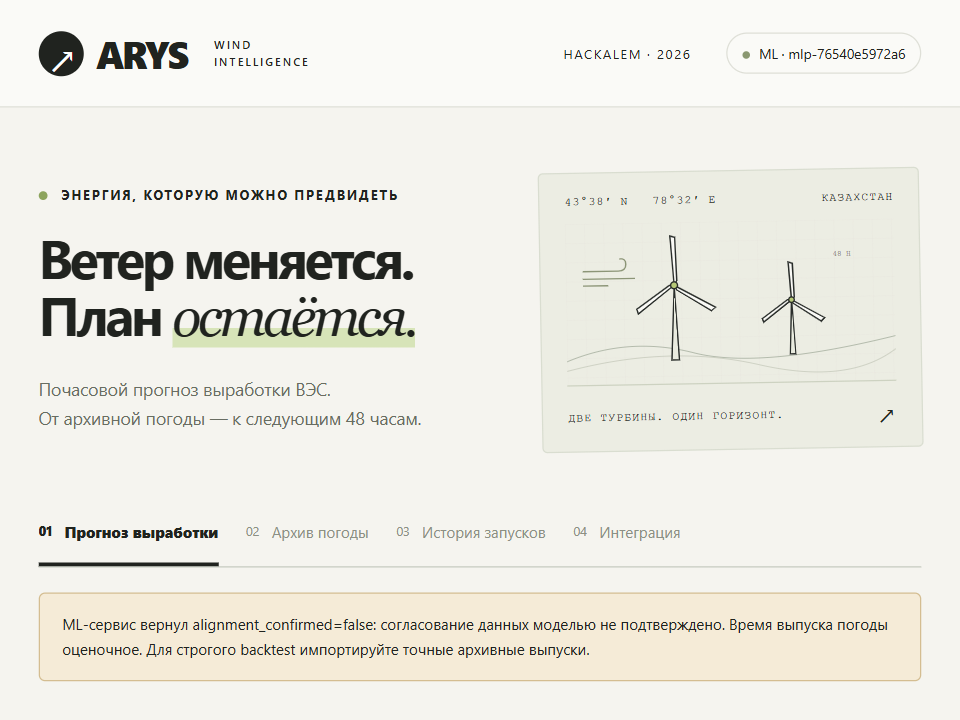

# HackAlem AI 2026 · Energetics

**ARYS — почасовой прогноз нормализованной мощности ветроэлектростанции на 24–48 часов.**



Командный проект **Арыс** для [HACK ALEM AI 2026](https://hackalem.ai/), трек «Энергетика». Владелец задачи — **Самрук-Казына**. Проект объединяет Django-портал, модуль погодных прогнозов и обученную ML-модель двух турбин. Фронтенд написан на HTML, CSS и JavaScript без фреймворков.

Это хакатонный прототип, а не промышленная система управления ВЭС. Веса включены: для инференса достаточно CPU, без GPU, облачного аккаунта и обучения. Временное согласование исходных измерений пока не подтверждено, поэтому модель возвращает `alignment_confirmed=false` и запускается только после явного согласия `--allow-provisional`.

[Запуск](#быстрый-запуск) · [Настройка сервисов](#настройка-сервисов) · [Исторический расчёт](#исторический-расчёт) · [Тесты](#тесты) · [Ограничения](#ограничения)

## Задача и возможности

По условиям трека система должна самостоятельно получать архивный прогноз погоды по координатам турбин, подготавливать данные, рассчитывать мощность и повторять процесс для каждого дня тестового февраля 2026 года. Погода должна быть известна на момент принятия решения, а не восстановлена из последующих наблюдений.

Реализованы:

- отдельный прогноз каждой из двух турбин на 48 последовательных часов; интерфейс показывает все 48 или первые 24;
- текущий прогноз и исторический replay с заданным моментом решения;
- загрузка JMA GSM, импорт точных архивных выпусков, проверка времён и единиц;
- обученная MLP-модель, CPU-инференс, проверка возможностей загруженного артефакта;
- неизменяемые погодные снимки, история, журнал этапов, экспорт CSV/JSON;
- кэш по погодному снимку, турбине и версии модели;
- повторный расчёт при обновлении входов и последовательный ежедневный backtest.

Ошибки сервисов остаются видимыми. Подмена прогноза демонстрационной мощностью или фактической погодой не выполняется.

## Как устроен проект

```text
Браузер · нативный HTML/CSS/JavaScript
   → Django · live/replay, валидация и оркестрация
      → Weather · JMA GSM или импортированный архив
      → SQLite · погодный снимок и происхождение данных
      → ML /v1/predict · 48 подготовленных часов
      ← 48 значений мощности, model_version, alignment_confirmed
   → проверка результата, кэш, история и график
```

Django отвечает за получение и выбор погоды, историческую доступность, хранение и кэш. ML-сервис на FastAPI получает готовую погоду и применяет уже загруженные веса. В `/v1/predict` нет скачивания погоды и обучения.

Agentic-поведение реализовано детерминированным управляющим процессом, **не LLM-агентом**. `refresh_forecasts` выполняет один проход обновлений; постоянный планировщик в проект не встроен. Для регулярной работы команду можно настроить в собственном планировщике.

## Быстрый запуск

Нужны **Python 3.12** и доступ к PyPI для установки. Выполняйте команды из корня этой копии проекта. Не используйте окружение из другого клона.

### Windows PowerShell

```powershell
cd HackAlem-AI-2026-Energetics
py -3.12 -m venv .venv
.venv\Scripts\python.exe -m pip install -r requirements.txt
.venv\Scripts\python.exe manage.py migrate
.venv\Scripts\python.exe manage.py seed_demo
```

`seed_demo` создаёт только две турбины с координатами из задания. Команда не обучает модель, не включает заглушку и не переписывает существующие координаты.

Сначала настройте погодные URL в следующем разделе, затем запустите оба сервиса:

```powershell
.venv\Scripts\python.exe tools\run_project.py --allow-provisional
```

Откройте [http://127.0.0.1:8000](http://127.0.0.1:8000), выберите турбину и источник Open-Meteo. ML-сервис запускается локально на порту 8001. `Ctrl+C` останавливает оба дочерних процесса.

Если порты заняты:

```powershell
.venv\Scripts\python.exe tools\run_project.py --allow-provisional --web-port 8010 --ml-port 8011
```

В этом случае портал доступен по [http://127.0.0.1:8010](http://127.0.0.1:8010). Чужие процессы запускатель не завершает. Не пересоздавайте `.venv`, пока из неё работают серверы: Windows может заблокировать `python.exe`.

### Linux / macOS

```bash
cd HackAlem-AI-2026-Energetics
python3.12 -m venv .venv
. .venv/bin/activate
python -m pip install -r requirements.txt
python manage.py migrate
python manage.py seed_demo
# Настройте переменные сервисов по следующему разделу.
python tools/run_project.py --allow-provisional
```

### Полностью офлайн-демонстрация

После установки зависимостей:

```powershell
.venv\Scripts\python.exe tools\run_project.py --demo --web-port 8010
```

Выберите «Демонстрационные данные». Этот режим использует явно обозначенные синтетическую погоду и аналитическую заглушку. Он проверяет интерфейс и оркестрацию, **не качество обученной модели**. Для проверки настоящих весов без погодного API используйте регрессионные тесты и включённые эталонные запросы.

## Настройка сервисов

**Чужих рабочих ключей и преднастроенных внешних адресов в этой версии нет. Каждый пользователь настраивает свои подключения.** Имена API-маршрутов сохранены: это контракт приложения, а не секреты.

[.env.example](.env.example) содержит пустые поля секретов и URL. Python **не загружает `.env` автоматически**: экспортируйте переменные в терминале или передавайте их средствами своей платформы. Перезапускайте сервисы после изменения окружения. Не вставляйте ключи в URL, файлы кода, GitHub Issues или скриншоты.

### Open-Meteo

Настройте отдельно текущий прогноз и **Previous Runs**, следуя [документации JMA](https://open-meteo.com/en/docs/jma-api) и [архивных прогнозов](https://open-meteo.com/en/docs/previous-runs-api). Публичные адреса ниже — справочные примеры для явного включения, не сохранённые настройки аккаунта:

```powershell
$env:OPEN_METEO_FORECAST_URL = 'https://api.open-meteo.com/v1/forecast'
$env:OPEN_METEO_PREVIOUS_RUNS_URL = 'https://previous-runs-api.open-meteo.com/v1/forecast'
```

Для Bash:

```bash
export OPEN_METEO_FORECAST_URL='https://api.open-meteo.com/v1/forecast'
export OPEN_METEO_PREVIOUS_RUNS_URL='https://previous-runs-api.open-meteo.com/v1/forecast'
```

Если ваш тариф требует ключ, задайте **свой** `OPEN_METEO_API_KEY` отдельно и используйте адреса, указанные для этого тарифа. Ключ передаётся провайдеру, но не записывается в погодный snapshot, cache metadata или manifest загрузчика. Доступность архива и лимиты зависят от сервиса; проверьте [условия Open-Meteo](https://open-meteo.com/en/licence).

Сетевые запросы передают выбранному провайдеру координаты турбин и даты. Без настроенного URL погодный модуль возвращает понятную ошибку `weather_configuration` (503), ничего не скачивает и не подставляет альтернативный источник.

Требуемые параметры модель задаёт сама:

```text
models=jma_gsm
hourly=wind_speed_10m,wind_direction_10m,temperature_2m
wind_speed_unit=ms
temperature_unit=celsius
timezone=UTC
```

Для Previous Runs используются соответствующие суффиксы `_previous_dayN`. Ветер 100 м, GFS, ICON, наблюдения или ERA5 нельзя просто переименовать в признаки обученного JMA-артефакта.

### ML-сервис

При `tools/run_project.py` локальный адрес ML формируется самим запускателем. Внешний ML URL не нужен.

Для отдельно развёрнутого сервиса задайте `ML_SERVICE_URL` — **свой полный адрес POST /v1/predict**, а при необходимости `ML_METADATA_URL`. При пустом metadata URL используется соседний `/v1/metadata`. Пример структуры адреса: `https://ml.example.invalid/v1/predict`; домен `example.invalid` — заглушка, его нужно заменить.

`ML_SERVICE_TOKEN` — одинаковый пользовательский Bearer-токен у Django и ML, **не ключ NVIDIA**. Локально он может быть пустым. Для удалённого доступа используйте HTTPS и отдельный случайный токен. Ссылка на GitHub не является запущенным API.

Запуск двух процессов вручную:

```powershell
# Терминал 1
.venv\Scripts\python.exe inference\serve.py --allow-provisional
```

```powershell
# Терминал 2, после настройки погоды
$env:ML_SERVICE_URL = 'http://127.0.0.1:8001/v1/predict'
.venv\Scripts\python.exe manage.py runserver 127.0.0.1:8000
```

При использовании токена задайте его в окружении обоих терминалов. Legacy-интеграция `WEATHER_PROVIDER_URL` / `WEATHER_PROVIDER_TOKEN` нужна только старому маршруту ML `/power/forecast`; единый проект её не использует, оставьте поля пустыми.

### Другие настройки

| Переменная | Назначение |
| --- | --- |
| `DJANGO_DEBUG` | `1` только для локальной разработки |
| `DJANGO_SECRET_KEY` | Собственный случайный секрет; в production минимум 50 символов |
| `DJANGO_ALLOWED_HOSTS` | Разрешённые имена хостов вашего развёртывания |
| `API_TOKEN` | Отдельный токен входящего Django API, не токен ML |
| `DJANGO_DB_PATH` | Путь SQLite; по умолчанию `db.sqlite3` в корне |
| `ML_BACKEND` | `http` по умолчанию; `demo` только явно |
| `HTTP_TIMEOUT` | Тайм-аут Django при вызове сервисов, 30 секунд |
| `MODEL_PATH` | По умолчанию `models/production/model.json` |
| `ALLOW_PROVISIONAL_MODEL` | `1` разрешает неподтверждённый артефакт, не подтверждая его корректность |

В debug-режиме отсутствующий Django secret генерируется на время процесса; после перезапуска сессии сбрасываются. Для постоянных сессий задайте свой стабильный секрет. Сгенерировать случайное значение можно командой `python -c "import secrets; print(secrets.token_urlsafe(48))"`. Используйте разные значения для разных назначений.

**NVIDIA/Brev, OpenAI и другие платные API для запуска портала и CPU-инференса не требуются.** Обучающий Brev-контроллер необязателен; для него пользователь отдельно настраивает собственные CLI-учётные данные и GPU-инстанс. Облачные задания не запускаются автоматически.

## Исторический расчёт

В live Django выбирает текущее время и следующий целый час. В replay пользователь задаёт момент решения `as_of`, **не время выпуска прогноза**.

Есть два варианта архива:

- `open_meteo`: fixed-offset Previous Runs. Время доступности оценочное, помечено `estimated_fixed_lead`; запас 8 часов не доказывает отсутствие информации из будущего.
- `archive`: импортированные оригинальные выпуски JMA с подтверждёнными `issued_at` и `available_at`. Выбирается последний доступный на `as_of` выпуск, покрывающий все 48 часов.

Формат: [Weather archive](docs/WEATHER_ARCHIVE.md). Пример в `docs/examples/archived-run-synthetic.json` намеренно синтетический и не принимается за реальный архив.

После импорта ваших проверенных выпусков и при работающем ML, в отдельном терминале:

```powershell
$env:ML_SERVICE_URL = 'http://127.0.0.1:8001/v1/predict'
.venv\Scripts\python.exe manage.py import_weather path/to/verified-run.json
.venv\Scripts\python.exe manage.py backtest --provider archive --turbine turbine_1 --output output/turbine-1.csv
.venv\Scripts\python.exe manage.py backtest --provider archive --turbine turbine_2 --output output/turbine-2.csv
```

Если ML использует токен или другой порт, задайте те же значения и здесь. Прогон по умолчанию охватывает **1–28 февраля 2026**, момент решения — 18:00 UTC предыдущего дня. Каждый день рассчитываются 48 часов, включая пересечения и выход последнего горизонта в март. Уже существующий CSV не перезаписывается. Ошибка останавливает прогон, сохраняя выполненную часть.

Один проход обновлений существующих прогнозов:

```powershell
.venv\Scripts\python.exe manage.py refresh_forecasts --limit 20
```

## ML-контракт и API

Основной ML endpoint — `POST /v1/predict`. Запрос содержит `schema_version=windpower.input.v1`, `turbine_id`, `weather_model=jma_gsm` и ровно 48 записей:

| Поле записи | Значение |
| --- | --- |
| `target_time` | ISO 8601 с часовым поясом, целые последовательные часы |
| `wind_speed_10m_ms` | Скорость на высоте 10 м, м/с, 0–100 |
| `wind_direction_10m_deg` | Направление, откуда дует ветер, от севера по часовой стрелке, 0–360° |
| `temperature_2m_c` | Температура на высоте 2 м, °C, −100…70 |

Ответ `windpower.output.v1` содержит 48 совпадающих времён, `predicted_normalized_power` в **[0, 1]**, версию и `alignment_confirmed`. Это доля нормализованной шкалы, не МВт и не проценты; график переводит её в проценты. Выбор 24 часов сокращает только отображение. Давление и метаданные выпуска остаются в Django.

Один запрос — одна турбина. `GET /v1/metadata` сообщает возможности реально загруженных весов. Неизвестные поля, строки вместо чисел, null, bool, NaN, пропуски и дубли часов отклоняются. Ошибки авторизации, модели, источника, сети и тайм-ауты не маскируются.

Ключевые маршруты Django:

| Метод | Маршрут | Назначение |
| --- | --- | --- |
| GET | `/api/v1/health/` | Состояние Django, не проверка всех зависимостей |
| GET | `/api/v1/turbines/` | Турбины |
| GET | `/api/v1/ml/metadata/` | Возможности ML |
| POST / GET | `/api/v1/forecasts/` | Расчёт / история |
| GET | `/api/v1/forecasts/{id}/` | Прогноз, погода, журнал и ошибки |
| POST | `/api/v1/forecasts/{id}/refresh/` | Проверка обновлений |
| GET | `/api/v1/forecasts/{id}/export.csv` | Экспорт |
| POST | `/api/v1/weather/forecast/` | Только погода |
| POST | `/api/v1/weather/import/` | Импорт архивного выпуска |

Подробности и готовые примеры: [дизайн интеграции](docs/ML_INTEGRATION.md), [ML-контракт](docs/ML_SERVICE_CONTRACT.md), [Django OpenAPI](docs/openapi.json), [ML OpenAPI](docs/ml-service.openapi.json), [48-часовой запрос](inference/examples/turbine_2-48h-request.json).

## Модель и результаты

Включён артефакт `mlp-76540e5972a6`: MLP 64 → 32 → 1, 2 881 параметр, обе турбины. Веса и нормализация экспортированы для NumPy. SHA-256 и происхождение: [manifest](models/production/manifest.json).

Обучающий набор содержит 96 900 примеров, соответствующих 48 450 парам «турбина–час» при двух погодных смещениях. Обучение — до октября 2025, validation — октябрь–декабрь, оценка — январь 2026.

| Январь 2026 | Обе турбины | Турбина 1 | Турбина 2 |
| --- | ---: | ---: | ---: |
| MAE | 0.178525 | 0.173897 | 0.183153 |
| RMSE | 0.238635 | 0.232772 | 0.244357 |

Источник: сохранённые [метрики обучения](models/production/metrics.json). При подготовке публичной версии модель **не переобучалась**. Это ошибки в долях нормализованной шкалы, не «процент точности». Январь просматривался в разработке и не является полностью слепым внешним тестом. Эти числа не описывают качество февральского replay.

[Создание новых моделей](docs/TRAINING.md) · [описание данных](docs/DATA.md) · [сравнение альтернатив](docs/MODEL_COMPARISON.md).

## Тесты

Полный набор включает маленькие синтетические обучающие фикстуры, поэтому ему нужен CPU PyTorch; для обычного запуска сервиса он не нужен.

```powershell
.venv\Scripts\python.exe -m pip install '.[test]'
.venv\Scripts\python.exe -m pip install torch==2.6.0 --index-url https://download.pytorch.org/whl/cpu
.venv\Scripts\python.exe -m pip check
.venv\Scripts\python.exe manage.py check
.venv\Scripts\python.exe manage.py makemigrations --check --dry-run
.venv\Scripts\python.exe -m pytest -q
.venv\Scripts\python.exe tools\check_publication.py
```

Если установлен Node.js: `node --check static/app.js`.

Тесты проверяют контракты, обе турбины, хеш весов, эталонные ответы, Django → настоящий ML по localhost, кэш, ошибки, авторизацию и исключение API-ключей из метаданных. Внешние погодные API и платные сервисы в них не вызываются. Для smoke test запущенного ML:

```powershell
.venv\Scripts\python.exe inference\smoke_test.py --url http://127.0.0.1:8001
```

Результаты проверки этой версии: [PUBLICATION_REVIEW](docs/PUBLICATION_REVIEW.md). Исторические отчёты от 23 сентября сохранены отдельно и не являются новым запуском тестов. GitHub Actions настроен, но его облачный статус подтверждается только после публикации.

## Docker и развёртывание

Для локальной демонстрации настройте погодные переменные, затем:

```powershell
$env:ALLOW_PROVISIONAL_MODEL = '1'
docker compose up --build
```

Портал — localhost:8000, ML — localhost:8001. Compose передаёт погодные настройки только Django, а межсервисный ML URL задаёт внутри сети контейнеров. Остановка: `docker compose down`; не добавляйте `-v`, если нужно сохранить базу.

**Docker-сборка не проверена в текущем окружении.** Compose использует development runserver и не предназначен для публикации в интернете. Для production нужны HTTPS, production-сервер, ограничения доступа и запросов, собственные секреты, обслуживание базы и static. При `DJANGO_DEBUG=0` требуются `DJANGO_SECRET_KEY`, `API_TOKEN` и корректные `DJANGO_ALLOWED_HOSTS`; для UI создайте пользователя через `manage.py createsuperuser`. Подробнее: [SECURITY.md](SECURITY.md).

## Ограничения

- Временная привязка десятиминутных измерений не подтверждена: `alignment_confirmed=false`. Флаг запуска не меняет этот статус.
- Previous Runs с фиксированным смещением не доказывает доступность точного выпуска на исторический момент. Для строгого конкурсного replay нужен проверенный архив выпусков.
- Предоставленные CSV обеих турбин заканчиваются 31 января 2026, хотя названия содержат февраль. Февральская фактическая мощность для оценки отсутствует.
- Инженерное определение нормализации и номинальные мощности требуют подтверждения; вывод в МВт не реализован.
- SQLite и синхронные запросы рассчитаны на демонстрацию и небольшую нагрузку. Публичное production-развёртывание и постоянный планировщик не подготовлены.

## Состав репозитория

```text
config/, common/          Django, настройки и общие проверки
forecasting/              Оркестрация, история, API и ML-клиент
weather_archive/          Погода, импорт выпусков, снимки
templates/, static/       Нативный интерфейс без внешних шрифтов/CDN
src/windpower/            Признаки, CPU-модель, FastAPI, обучение
models/production/        Веса, manifest и сохранённые метрики
inference/               Запуск ML, эталонные запросы и smoke test
tools/                   Совместный запуск и проверка публикации
training_toolkit/         Явные команды подготовки и обучения
scripts/                 Обучение, проверки, необязательный Brev
tests/                   Регрессионные и интеграционные тесты
docs/, reports/           Контракты, методология, результаты
```

## Происхождение и публикация

Основа — [командный репозиторий](https://github.com/BAITC-Hacks/hack-15d1fa83-team), `main`, коммит `4a79b39`. Сохранены авторство команды и происхождение весов; эта версия не заявляет единоличное авторство. Подробности: [NOTICE.md](NOTICE.md).

Подготовленная копия не переносит старую Git-историю, личные настройки, ключи, CSV организаторов, исходный DOCX, погодный кэш или рабочую базу. Внешние адреса задаются пользователем; публичные ссылки в документации оставлены как справочные.

### Если возникла ошибка

- `weather_configuration`: задайте погодные URL в том же терминале, где запускаете Django.
- `ml_configuration`: используйте совместный запускатель или задайте свой ML URL.
- `401`: проверьте совпадение ML-токенов; входящий Django `API_TOKEN` — другой секрет.
- `422`: проверьте JMA GSM, высоту ветра 10 м, 48 часов и поддерживаемую турбину.
- `ModuleNotFoundError`: установите requirements именно Python из текущей `.venv`.
- «Port occupied»: выберите другие порты, не пересоздавайте работающее окружение.
- Архив недоступен: проверьте покрытие провайдера или импортируйте подтверждённые выпуски. Автоматического fallback нет.
